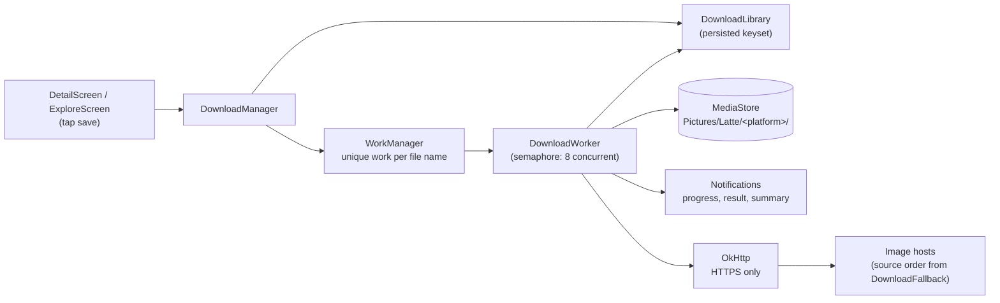
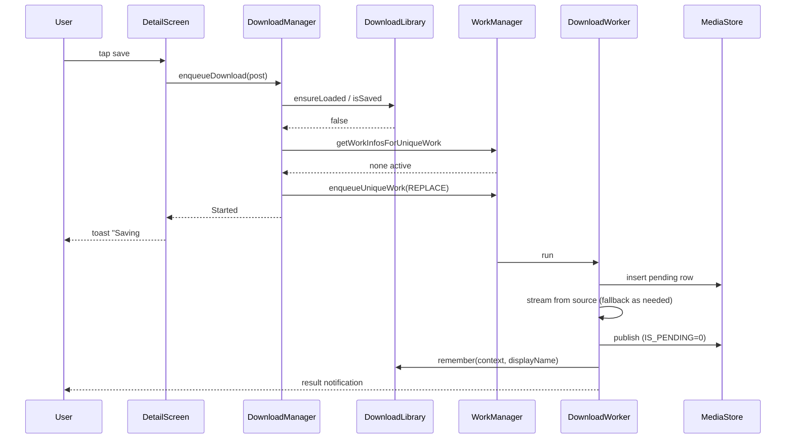
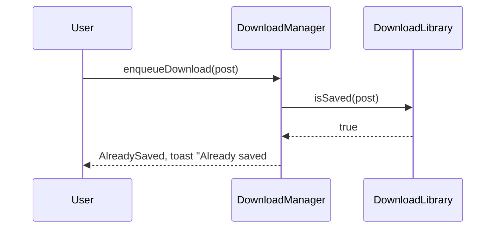

# Download workflow

How a "save image" action becomes a file in `Pictures/Latte/<platform>/`. Covers the
dedup gates, the WorkManager job, source fallback, MediaStore writes, and notifications.

Key files:

- `ui/detail/DetailScreen.kt`, `ui/explore/ExploreScreen.kt`: user entry points
- `data/download/DownloadManager.kt`: enqueue and dedup decisions
- `data/download/DownloadLibrary.kt`: per-platform keyset of saved works
- `data/download/DownloadIdentity.kt`: file names, keys, toast labels
- `data/download/DownloadFallback.kt`: source order and fallback rules
- `DownloadWorker.kt`: the WorkManager job that moves bytes into MediaStore
- `data/download/DownloadNotificationPolicy.kt`: completed-notification cap

## Identity

A saved file is named `<platform>_<id>[_pN].<ext>`, for example `yande.re_1271440.jpg`
or `pixiv_75034219_p2.png`. The name carries no title or tags, so the same work always
gets the same name.

- **Key** (`DownloadIdentity.key`): `id`, or `id:pN` for a multi-page work. Dedup compares
  keys, never display names.
- **Album path**: `Pictures/Latte/<platform externalId>/`.
- **Parse** (`DownloadIdentity.parseKey`): recovers the key from a stored file name. This
  is the only place that defines key semantics for files on disk.

## Components

## Enqueue (`DownloadManager.enqueueDownload`)

Called once per post by Detail, or once per post by Explore's batch action
(`enqueueBatchDownload`, which loops and tallies results). The checks run in this order
and stop at the first hit:

1. **Saved check.** `DownloadLibrary.ensureLoaded` scans storage once per process if it
   has not loaded yet. Then `isSaved(post)` checks the keyset. A hit returns
   `AlreadySaved` and enqueues nothing.
2. **In-flight check.** The unique WorkManager work for this file name is looked up. If it
   is `RUNNING`, `ENQUEUED`, or `BLOCKED`, the result is `AlreadyRunning`.
3. **Enqueue.** Candidate URLs come from `DownloadFallback.candidateUrls`. The request
   carries the source list, display name, album path, MIME type, and headers (Pixiv
   needs a `Referer`). It is enqueued with `enqueueUniqueWork(name, REPLACE, request)`,
   with exponential backoff from 10 seconds and non-expedited execution. It returns
   `Started`.

Callers map results to toasts: `Saving #id`, `Already saved #id`, `Already downloading #id`,
or `Couldn't save`.

Before any check, `pruneStaleNotifications` clears old notifications.

## Source order (`DownloadFallback`)

- **Pixiv:** all non-preview variants, sorted by host: `i.pximg.net` first, then
  `i.pixiv.re`, then `pixiv.cat`. The worker tries them in that order.
- **Other platforms:** one URL, the preferred variant or the post's best variant.

Fallback rules, applied per source when a request fails (`shouldFallback`):

- transport error (no status): fall back
- 2xx with a non-image `Content-Type` on a Pixiv host: fall back
- 403, 404, 408, 429, or 5xx: fall back
- anything else: fail. The last source never falls back.

## Worker (`DownloadWorker`)

Runs under a semaphore of 8 permits, so at most eight saves run at once in the process. The bytes move through OkHttp's async dispatcher, so they share the per-host budget with previews.

1. **Start.** Posts a foreground notification "Downloading image" with an indeterminate
   progress bar. Failure to become foreground is logged and ignored.
2. **Pre-check.** `saveImage` looks for the exact display name among published items. If
   found, the result is `already_saved`. This covers the race where another worker
   finished first.
3. **Pending item.** Reuses a pending MediaStore row with the same name if one exists,
   otherwise inserts a new row with `IS_PENDING = 1`.
4. **Transfer.** `downloadToMediaStore` streams each source over HTTPS into the row.
   - Resumes from the pending size with `Range`, but only for single-source works (a
     partial file from another source is never resumed).
   - A `416` response restarts the source from byte 0.
   - Progress updates are throttled to every 250 ms and posted as notification progress
     and as work progress data.
5. **Collision check.** After transfer, the exact name is checked again among published
   items. If another worker published it meanwhile, this row is deleted and the result is
   `already_saved`.
6. **Publish.** Clears `IS_PENDING`. Result: `completed`.
7. **Remember.** `DownloadLibrary.remember(context, displayName)` adds the key to the keyset
   and persists it, so later taps (this process or the next launch) dedup without a rescan.
8. **Result.** Posts the result notification with a thumbnail. Older completed
   notifications beyond 8 are cancelled, and a group summary is updated.

Error handling:

- `IOException` retries up to `MAX_RETRY_COUNT` (2), then fails with a notification.
- Any other exception fails immediately with a failure notification.
- Cancellation is rethrown.

## Keyset lifecycle (`DownloadLibrary`)

The keyset is built once and then persisted in SharedPreferences (`download_library`), one
string set per platform, plus a `built` flag.

- **First load** (`ensureLoaded`, once per process): if `built` is unset, one MediaStore scan
  builds the keyset and persists it. If set, the stored sets are loaded without a scan.
- **Growth:** `remember` adds each finished download's key and persists. No rescans.
- **Rebuild** (`refresh`, Settings → Rebuild Download Index): rescans and replaces the set.
  This is the only way to pick up files added or deleted outside the app.
- **Permission:** `built` is set only when the scan ran with `READ_MEDIA_IMAGES`. Without it,
  the scan can see nothing, so the library stays unbuilt and the next load with permission
  scans again.

Files changed by other apps are not tracked until Rebuild. A deleted file still counts as
saved until then.

## Notifications

| Stage | Notification | Channel |
| --- | --- | --- |
| Worker starts | Ongoing "Downloading image" with progress | `latte_downloads` |
| Result | Completed notification with thumbnail | same |
| Failure | Failure notification | same |
| Group | Summary notification, `SUMMARY_NOTIFICATION_ID` | same |

Completed notifications are capped at 8 by `DownloadNotificationPolicy`, under Android's
per-package limit of 50.

A dedup hit (`AlreadySaved` or `AlreadyRunning`) enqueues no worker, so it shows no
"Downloading" notification. It only shows an in-app toast.

## Sequence: tap save on an unsaved post

## Sequence: tap save again on the same post

After the first save completes, the keyset already holds the key (step 7 above).

Without the `remember` step, the keyset would miss files saved in the current process. A
second tap would then enqueue a worker and show "Downloading image" before the worker
found the file already exists.

## Open points

- The first launch pays one MediaStore scan to build the keyset. After that the scan
  only runs on Rebuild or when the library was never built with permission.
- Batch enqueue calls `enqueueDownload` in sequence, so each post still does a
  WorkManager lookup.
